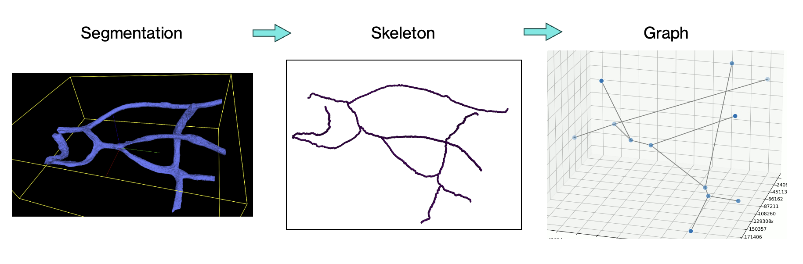
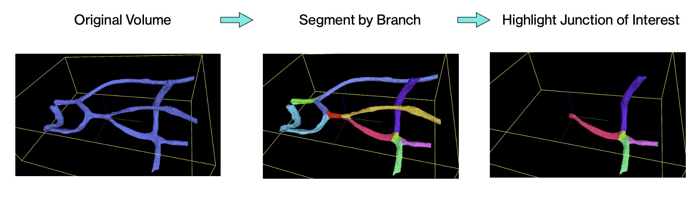
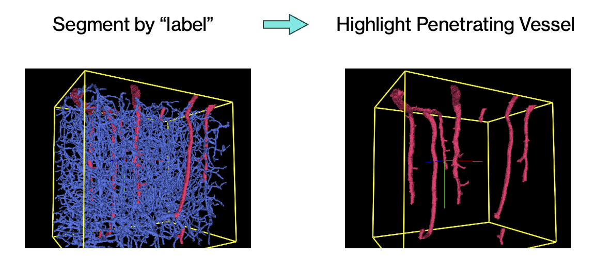
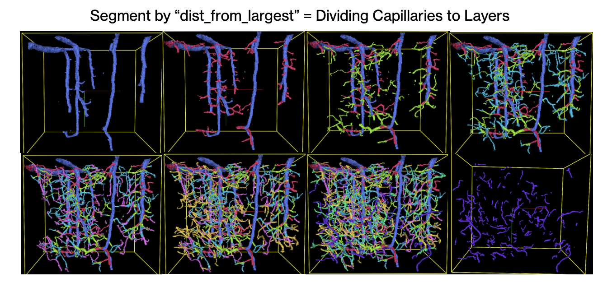
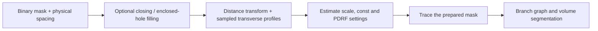

# Vessel2Graph

**A graph-based segmentation toolbox for blood vessel volumes.**

Vessel2Graph turns volumetric vessel masks into sparse graphs that can be explored,
measured, and mapped back into the original volume. It is designed for EM vascular
analysis, where selecting a vessel by its connections can be more useful than selecting
whatever happens to fall inside a spatial region.



## The idea: work on the graph, return to the volume

A vessel network contains both geometry and connectivity. Skeletonization provides a
compact representation on which branches, radii, and neighborhood relationships can be
computed. Those attributes then drive dense voxel assignment and visualization.

The goal is to make vascular analysis **topology-aware, customizable, and reproducible**:

- Select connected branches without including unrelated vessels that happen to lie nearby.
- Group vessels by geometric attributes and inspect their position within the network.
- Reuse one saved skeleton and graph for multiple segmentation questions.
- Keep input selection, physical spacing, processing choices, and outputs explicit.

The packaged pipeline carries this original approach into configurable, reusable stages.
It generates a skeleton by topological thinning (the default: loops are preserved and no
caliber-dependent parameter is needed) or with [Kimimaro](https://github.com/seung-lab/kimimaro),
loads a saved skeleton, and can estimate TEASAR settings from the binary input itself.

## Explore the vessel network

The following figures are retained from the original Vessel2Graph showcase. They
illustrate the available operations; they are not new benchmarks of the packaged version.

### Segment by branch



Assign separate IDs to topological branches and inspect the branches surrounding a
junction. This makes it possible to highlight the connected structures of interest
without selecting nearby, unrelated portions of the volume.

**Configuration:** `segment.attribute: branch`.

### Segment by vessel size



Group branches by their median skeleton radius to distinguish larger and smaller
vessels. The original example shows how this can highlight penetrating vessels in a
MICrONS volume. Size classes describe geometry; they do not independently identify
arteries, veins, or biological vessel types.

**Configuration:** `segment.attribute: label`; `graph.radius_clusters` sets the requested
number of size groups. Radius can also be exported directly with `segment.attribute: radius`.

### Segment by network distance from larger vessels



Follow the network outward from the largest caliber group to inspect successive layers
of connected branches. Distance here is measured in **branch-graph hops**, not straight-line
or physical path distance. The stored convention is one-based: largest-group branches
start at 1, while unreachable branches are 0.

**Configuration:** `segment.attribute: dist_from_largest`.

## New: estimate TEASAR parameters from the volume

A useful graph starts with a useful skeleton. Manually tuning tracing parameters can
become a substantial part of the work, especially when segmentation defects create
false branches or displace junctions. Vessel2Graph now includes an experimental route
from **binary mask and physical spacing to a proposed TEASAR parameter set**.



The estimator measures interior distance and transverse extent, then derives `scale`,
`const`, `pdrf_exponent`, and `pdrf_scale`. It saves the measurements and a candidate
configuration. **No accepted skeleton is used to derive these parameters.** Saved
skeletons serve as evaluation references only.

Preparation is explicit: optional physical-radius binary closing can repair narrow
surface clefts that ordinary enclosed-hole filling cannot reach. The prepared mask is
used for **both parameter estimation and skeletonization**, while the original is retained.

In the macaque development example, a 1024 nm closing radius removed a visible surface
cleft. The resulting skeleton eliminated a false terminal branch and correctly
redistributed a thick junction region among its three adjoining branches, according to
visual review of the mask and branch overlays. The accepted result has 11 branches in
one connected component. This is a promising inspected example, not a general accuracy claim.

**Current scope:** the four tracing parameters are measurement-derived; closing radius
is still user-selected. Mixed-caliber generalization and Linux cluster execution remain
next evaluation steps. See the [method and evidence](docs/PHASE2_BINARY_ONLY.md).

## A reusable pipeline

| Stage | Saved result |
|---|---|
| Estimate | Measurements, prepared mask, candidate configuration |
| Skeletonize | Physical-coordinate skeleton and radii |
| Build graph | Branch paths, connectivity, size classes, metrics |
| Assign volume | Dense branch, caliber, radius, or graph-distance values |
| Inspect | Neuroglancer layers and branch-wise comparisons |

YAML configs replace editing parameters inside a script. Stage fingerprints support
resuming compatible work; separate output directories preserve experiments. Input label
selection and anisotropic spacing are explicit. Disconnected components are retained;
proximity alone does not trigger automatic joining.

Graph analysis is sparse, but current preparation and tracing still allocate full-volume
arrays. Large datasets require appropriate memory, typically on a compute cluster.
The original large-volume runtime claims have not been re-benchmarked for this version.

## Get started

Use an isolated Python 3.11 environment in the repository root:

```sh
python -m pip install -e ".[test]" -c requirements-core.txt
```

Copy `configs/example.yaml` to `configs/default.local.yaml` and set the HDF5 path,
selected labels, **ZYX voxel spacing in nanometers**, output directory, and memory budget.
Then, using the example output directory:

```sh
python -m vessel2graph estimate --config config.yaml
python -m vessel2graph graph --config runs/dataset/estimation-volume-v2/candidate.yaml
```

For explicitly selected preparation, add `--fill-holes --closing-radius-nm VALUE` to
`estimate`. The macaque experiment used 1024 nm; this is not a universal default.
Use the generated candidate config for subsequent stages so tracing uses the prepared mask.

For dense segmentation, select `segment.attribute` in the config before estimation,
then run `segment` using the generated candidate. Install `".[view]"` with the same
constraints to inspect saved outputs in Neuroglancer.

[Installation and commands](docs/QUICKSTART.md) · [Pipeline settings](docs/PIPELINE.md) ·
[Visualization](docs/VISUALIZATION.md) · [Cluster handoff](docs/CLUSTER_HANDOFF.md)

## Where this goes next

The next development focus is evaluating strongly mixed vessel calibers on the cluster,
including sampling coverage, thin-branch preservation, and preparation-scale selection.
Other directions include richer branch descriptors, improved caliber grouping, and
biological classification informed by more than radius. Applying graph-driven volume
analysis to other branching structures remains a longer-term possibility.

The original figures and source lineage are recorded in [image provenance](images/README.md)
and [project context](docs/PROJECT_CONTEXT.md). Publication preparation, including
reproducible examples, licensing and citation metadata, is tracked in
[the publication notes](docs/PUBLICATION.md).
